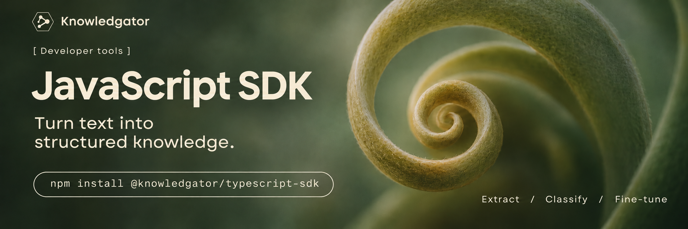

<h1>Knowledgator TypeScript SDK</h1>

<div align="center">

<a href="https://platform.knowledgator.com/">
  
</a>

<p>
  <a href="https://docs.knowledgator.com/docs/sdks/typescript/"></a>
  <a href="https://platform.knowledgator.com/"></a>
  <a href="https://www.npmjs.com/package/@knowledgator/typescript-sdk"></a>
  <a href="https://www.npmjs.com/package/@knowledgator/typescript-sdk"></a>
  <a href="https://www.npmjs.com/package/@knowledgator/typescript-sdk"></a>
  <a href="https://www.typescriptlang.org/"></a>
  <a href="https://github.com/Knowledgator/knowledgator-sdk.js/blob/main/LICENSE"></a>
</p>

</div>

The Knowledgator TypeScript SDK provides access to the Knowledgator APIs for zero-shot classification and information extraction tasks. Built for Node.js 18+, it ships with ESM and CommonJS builds and full TypeScript types, uses async/await for all operations, and supports both standard API access and RapidAPI integration.

### Key Advantages

- **Efficiency**: Based on non-generative technologies, our solutions are _100×_ faster and more cost-efficient.
- **Precision**: Designed and tailored to information extraction needs, our models demonstrate better precision than LLMs.
- **Interpretability**: Every processing result comes in structured form with a confidence score, offering a reliable indicator of precision to guide your trust in automation.
- **Customisability**: Our models can be fine-tuned with a few examples to achieve results on par with supervised models.
- **Modularity**: Naturally providing structured outputs, our APIs can be chained to solve complex end-to-end information extraction tasks.

### Available Models

- `Comprehend-it`: An efficient and accurate zero-shot and few-shot classifier ideal for text.
- `Extract-it`: Fast, interpretable, and accurate information extraction tool that efficiently handles different extraction tasks, like NER and relation extraction.
- `Instruct-it`: Extraction of structured information from raw text based on provided schema.
- `Link-it` (coming soon): Zero-shot entity-linking tool that supports entity extraction, disambiguation, and linking to custom databases.

### Available Services

- `Datasets`: Manage datasets and raw data for NER, text classification, and relation extraction.
- `Fine-tuning`: Fine-tune models with your own datasets for improved performance.
- `Open Models`: Access finetuned or custom models using dynamic identifiers.

## Documentation

Knowledgator API reference and guides are available [here](https://docs.knowledgator.com/docs/sdks/typescript/). For detailed endpoint specifications, refer to the API documentation.

## Quick Installation

> **Node.js Version Policy**: Supports Node.js 18+. Versions reaching end-of-life get a 3-month grace period before updates.

Install via npm:

```bash
npm install @knowledgator/typescript-sdk
```

Or with yarn:

```bash
yarn add @knowledgator/typescript-sdk
```

Or with pnpm:

```bash
pnpm add @knowledgator/typescript-sdk
```

You can also install from source by cloning the repo:

```bash
git clone git@github.com:Knowledgator/knowledgator-sdk.js.git
cd knowledgator-sdk.js
npm install
npm run build
```

## Quick Start

### API Key Setup

Before using the SDK, obtain a Knowledgator API key from [platform.knowledgator.com](https://platform.knowledgator.com/account/api-keys).

Set your API key as an environment variable:

```bash
$ export KG_API_KEY="your_api_key_here"
```

You can write it to zsh in the following way:

```bash
# Set Knowledgator API Key (using zsh for example)
$ echo 'export KG_API_KEY=[your_key_here]' >> ~/.zshenv

# Reload the environment (or open a new terminal)
$ source ~/.zshenv
```

With the variable set, `createClient()` picks the key up automatically (it checks `KG_API_KEY`, then `KG_MCP_API_KEY`, then `KNOWLEDGATOR_API_KEY`). Alternatively, pass the key directly: `createClient('your-api-key')`.

### SDK Example Usage

```typescript
import { createClient } from '@knowledgator/typescript-sdk';

// Automatically reads KG_API_KEY, KG_MCP_API_KEY, or KNOWLEDGATOR_API_KEY from environment
const client = createClient();

const response = await client.comprehend.it({
  text: 'Earth is beautiful',
  tasks: {
    topic: {
      type: 'classify',
      labels: ['positive', 'negative', 'neutral'],
    },
  },
});

console.log(response);
```

### Basic Classification (Comprehend)

Use the `comprehend.it` method for zero-shot text classification.

```typescript
import { createClient } from '@knowledgator/typescript-sdk';

const client = createClient('your-api-key-here');

const result = await client.comprehend.it({
  text: 'Earth is beautiful',
  tasks: {
    topic: {
      type: 'classify',
      labels: ['geography', 'sport'],
      threshold: 0.5,
      examples: [{ text: 'Example text', label: 'geography' }],
    },
  },
});

console.log(result); // Outputs ComprehendResults with classifications
console.log(result.outputs.topic); // Directly access parsed task output
```

## Table of Contents

- [Information Extraction (Extract)](#information-extraction-extract)
- [Relation Extraction](#relation-extraction)
- [Summarization](#summarization)
- [Structured Extraction (Instruct)](#structured-extraction-instruct)
- [Dataset Management](#dataset-management)
- [Raw Data Management](#raw-data-management)
- [Fine-tuning](#fine-tuning)
- [Open Models](#open-models)
- [Model Types: LoRA Adapters vs. Open Models](#model-types-lora-adapters-vs-open-models)
- [Configuration Options](#configuration-options)
- [RapidAPI Integration](#rapidapi-integration)
- [Available Resources and Operations](#available-resources-and-operations)
- [Retries](#retries)
- [Error Handling](#error-handling)
- [Custom HTTP Configuration](#custom-http-configuration)
- [Authentication](#authentication)
- [Logging and Debugging](#logging-and-debugging)
- [TypeScript Support](#typescript-support)
- [Development](#development)

## Information Extraction (Extract)

Use the `extract.it` method for zero-shot named entity recognition (NER).

```typescript
import { createClient } from '@knowledgator/typescript-sdk';

const client = createClient('your-api-key-here');

const result = await client.extract.it({
  text: 'Extract entities from this text.',
  tasks: {
    entities: {
      type: 'span',
      labels: ['person', 'location'],
      threshold: 0.5,
      instruction: 'Custom prompt for extraction',
    },
  },
});

console.log(result); // Outputs ExtractResults with entities
console.log(result.outputs.entities); // Directly access parsed task output
```

## Relation Extraction

Use `extract.relations` for extracting relations between entities.

```typescript
import { createClient } from '@knowledgator/typescript-sdk';

const client = createClient();

const result = await client.extract.relations({
  text: 'Text with entities and relations.',
  entities: ['person', 'organization'], // 'entities' is the primary field ('labels' is accepted as an alias)
  relations: ['works_for', 'located_in'],
  threshold: 0.5,
  prompt: 'Custom relation prompt',
  rules: [{ rule: 'example rule' }],
});

console.log(result.outputs); // Outputs array of extracted RelationResult objects
```

## Summarization

Use `extract.summary` for text summarization.

```typescript
import { createClient } from '@knowledgator/typescript-sdk';

const client = createClient('your-api-key-here');

const result = await client.extract.summary({
  text: 'Long text to summarize.',
  threshold: 0.5,
  prompt: 'Custom summarization prompt',
});

console.log(result); // Outputs ExtractSummaryResults
```

## Structured Extraction (Instruct)

Use `instruct.it` for extracting structured information based on a schema.

```typescript
import { createClient } from '@knowledgator/typescript-sdk';

const client = createClient('your-api-key-here');

const result = await client.instruct.it({
  text: 'John Doe works at Acme Corp as a Software Engineer.',
  template: JSON.stringify({
    name: '',
    company: '',
    position: '',
  }),
  output_type: 'json',
});

console.log(result); // Outputs InstructItResults with structured data
```

## Dataset Management

Manage datasets for training and fine-tuning models.

### List Datasets

```typescript
import { createClient } from '@knowledgator/typescript-sdk';

const client = createClient('your-api-key-here');

const result = await client.datasets.list({
  offset: 0,
  limit: 10,
  type: 'ner',
});

console.log(result); // Outputs ListDatasetsResults
```

### Create Dataset

```typescript
import { createClient } from '@knowledgator/typescript-sdk';

const client = createClient();

const result = await client.datasets.create({
  name: 'My NER Dataset',
  type: 'ner',
  format: 'jsonl',
  short_description: 'Dataset for named entity recognition',
  parent_dataset_id: '73a078ff-360a-48ea-bb2f-fe6add05289e', // Links to parent dataset for version control
});

console.log(result); // Outputs DatasetCreationResponse { id, status }
```

### Download Dataset

```typescript
import { createClient } from '@knowledgator/typescript-sdk';

const client = createClient();

// Direct download to local file
await client.datasets.download('dataset-uuid', { filePath: './dataset.json' });

// In-memory parse
const data = await client.datasets.download('dataset-uuid', { returnData: true });

// Streaming chunks with async generator (memory-efficient for large datasets)
for await (const chunk of client.datasets.streamDownload('dataset-uuid')) {
  // Process chunk (Uint8Array)
}
```

### Upload File to Dataset

```typescript
import { createClient } from '@knowledgator/typescript-sdk';
import { readFileSync } from 'fs';

const client = createClient();

const file = readFileSync('data.jsonl');
const result = await client.datasets.upload('dataset-id', { file });

console.log(result); // Outputs DatasetCreationResults
```

## Raw Data Management

Raw data entries can be managed similarly to datasets using the `datasets` API.

### List Raw Data

```typescript
const result = await client.datasets.listData({ limit: 10 });
console.log(result); // Outputs ListDataResults
```

### Create Raw Data

```typescript
const file = readFileSync('raw_data.jsonl');
const result = await client.datasets.createData({
  name: 'My Raw Data',
  type: 'ner',
  format: 'jsonl',
  file,
});
console.log(result);
```

## Fine-tuning

Fine-tune models with your own datasets.

### Start Training

```typescript
import { createClient } from '@knowledgator/typescript-sdk';

const client = createClient('your-api-key-here');

const result = await client.finetuning.startTraining({
  model_id: 'base-model-id',
  dataset_id: 'dataset-id',
  hyperparameters: {
    epochs: 10,
    batch_size: 16,
    learning_rate: 0.0001,
  },
});

console.log(result); // Outputs TrainingObject
```

### List Training Jobs

```typescript
import { createClient } from '@knowledgator/typescript-sdk';

const client = createClient('your-api-key-here');

// List successful trainings only
const successful = await client.finetuning.listTrainings({
  status: 'completed',
  limit: 10,
});

// List active trainings with pagination
const result = await client.finetuning.listTrainings({
  offset: 0,
  limit: 10,
  status: 'active',
});

console.log(result); // Outputs ListTrainingsResults
```

### Get Training Metrics

```typescript
import { createClient } from '@knowledgator/typescript-sdk';

const client = createClient('your-api-key-here');

const result = await client.finetuning.getMetrics('training-id', {
  metric: 'loss',
  offset: 0,
  limit: 100,
});

console.log(result); // Outputs ListMetricsResults
```

## Open Models

Interact with custom or finetuned standalone full models using dynamic model identifiers.

```typescript
import { createClient } from '@knowledgator/typescript-sdk';

const client = createClient('your-api-key-here');

// Initialize a model client for a standalone full model
const model = client.model('m-d9be7ede307943439a30c6f814026566');

// Default prediction invokes POST /inference/{model_id}/
const response = await model.predict({
  text: 'Smartphone with 120Hz OLED screen and 5000mAh battery',
  labels: ['Electronics', 'Apparel', 'Home Goods'],
});

// Shorthand for method-based inference (invokes POST /inference/{model_id}/{method}/)
const extractor = client.model('m-d9be7ede307943439a30c6f814026566', 'relations');
const result = await extractor.predict({ text: 'Apple released iPhone in Cupertino.' });

// Explicitly call a specific sub-method
const summary = await model.call('relations', { text: 'Apple released iPhone in Cupertino.' });
```

## Model Types: LoRA Adapters vs. Open Models

Knowledgator supports two distinct types of fine-tuned and custom models:

| Model Type | Platform Representation | Where to Run Inference | How to Call |
| :--- | :--- | :--- | :--- |
| **LoRA Adapters** | `type="adapter"` (attached to a base service like `comprehend-it` or `extract-it`) | Base Service Endpoint (`/inference/comprehend/`, `/inference/extract/`) with `KnowledgatorAPI-Model-ID` header | `client.comprehend.it({ ..., adapter_id: "<adapter-id>" })` |
| **Open Models** | `type="model"` (standalone full model, e.g. fine-tuned `gliclass-x-base`, `gliner-base`) | Dedicated Endpoint (`/inference/{model_id}/` or `/inference/{model_id}/{method}/`) | `client.model("<model-id>").predict(...)` or `client.model("<model-id>", "<method>").predict(...)` |

### Using a LoRA Adapter

When fine-tuning creates a lightweight adapter (`type="adapter"`), supply `adapter_id`:

```typescript
// Zero-shot classification with your fine-tuned LoRA adapter
const res = await client.comprehend.it({
  text: 'Smartphone with 120Hz OLED screen and 5000mAh battery',
  tasks: {
    topic: {
      type: 'classify',
      labels: ['Electronics', 'Apparel', 'Home Goods'],
    },
  },
  adapter_id: 'your-adapter-id', // Automatically passes KnowledgatorAPI-Model-ID header
});
```

### Using a Full Open Model

When fine-tuning produces a standalone model or when using standalone full models (`type="model"`), route through `client.model(...)`:

```typescript
// Predict using a standalone full open model (e.g. fine-tuned gliclass or gliner)
const model = client.model('m-d9be7ede307943439a30c6f814026566');

// The input payload matches the expected schema of the model (e.g. text + labels)
const res = await model.predict({
  text: 'Smartphone with 120Hz OLED screen and 5000mAh battery',
  labels: ['Electronics', 'Apparel', 'Home Goods'],
});
console.log(res);
```

> ⚠️ **Important**: Do not pass a standalone Open Model ID as `adapter_id` to `comprehend.it` or `extract.it`. The base service will reject it with HTTP 503 (`server.resource_unavailable`). Always use `client.model(model_id).predict(...)` for Open Models.

## Configuration Options

The SDK supports various configuration options for customization:

```typescript
import { createClient } from '@knowledgator/typescript-sdk';

const client = createClient('your-api-key-here', {
  // API provider: 'knowledgator', 'rapidapi', or 'custom'
  provider: 'knowledgator',

  // Request timeout in milliseconds (default: 60000)
  timeout: 30000,

  // Enable debug logging
  debug: true,

  // Validate API responses (recommended for production)
  validateResponses: true,

  // Retry policy configuration
  retryPolicy: {
    maxTries: 3,
    baseDelay: 0.25,
    maxDelay: 10,
    retryableStatuses: [408, 409, 429],
    jitter: true,
    jitterMin: 0.5,
    jitterMax: 1.5,
  },

  // Custom request/response interceptors
  requestInterceptor: (init: RequestInit) => {
    console.log('Request:', init);
    return init;
  },
  responseInterceptor: (response: Response) => {
    console.log('Response:', response.status, response.statusText);
    return response;
  },
});
```

## RapidAPI Integration

For RapidAPI-hosted endpoints:

```typescript
import { createClient } from '@knowledgator/typescript-sdk';

const client = createClient('your-rapidapi-key-here', {
  provider: 'rapidapi',
});

// Usage is the same as above (comprehend, extract and instruct are available via RapidAPI;
// other resources throw RapidApiNotSupportedError)
const result = await client.comprehend.it({
  text: 'Text to classify',
  tasks: {
    topic: {
      type: 'classify',
      labels: ['positive', 'negative'],
    },
  },
});
```

## Available Resources and Operations

### Comprehend API

- `it(request)`: Zero-shot classification with confidence scores and structured output

### Extract API

- `it(request)`: Zero-shot named entity recognition (NER)
- `relations(request)`: Relation extraction between entities
- `summary(request)`: Text summarization with customizable prompts

### Instruct API

- `it(request)`: Structured information extraction based on schema

### Datasets API

- `list(request)`: List datasets with optional filtering
- `create(request)`: Create a new dataset
- `get(datasetId)`: Get dataset details by ID
- `update(datasetId, request)`: Update dataset metadata
- `delete(datasetId)`: Delete a dataset
- `upload(datasetId, request)`: Upload a file to an existing dataset
- `download(datasetId, options)`: Download a dataset to a file (`filePath`) or into memory (`returnData`)
- `streamDownload(datasetId, options)`: Stream a dataset as `Uint8Array` chunks (async generator)
- `listFormats(request)`: List available dataset formats
- `generatePlan({ prompt })`: Generate a dataset plan from a prompt
- `generate(request)`: Generate a synthetic dataset

### Raw Data (Datasets API)

- `listData(request)`: List raw data entries
- `createData(request)`: Create a raw data entry
- `getData(dataId)`: Get raw data details by ID
- `updateData(dataId, request)`: Update raw data metadata
- `deleteData(dataId)`: Delete a raw data entry
- `uploadData(dataId, request)`: Upload a file to an existing raw data entry

### Finetuning API

- `createBaseModel(request)`: Create a new base model for training
- `listModels(request)`: List available base models
- `getModel(modelId)`: Get model details by ID
- `startTraining(request)`: Start a new training job
- `listTrainings(request)`: List training jobs with optional filtering
- `getTraining(trainingId)`: Get training job details by ID
- `deleteTraining(trainingId)`: Delete a training job
- `stopTraining(trainingId)`: Stop a running training job
- `listEvents(trainingId, request)`: List events for a training job
- `getMetrics(trainingId, request)`: Get training metrics for a specific metric type
- `getEvaluations(trainingId)`: Get evaluation results for a training job

### Models API

- `create(request)`, `list(request)`, `get(modelId)`: Same as the base-model methods on the Finetuning API, exposed as `client.models`

### Open Models

- `client.model(modelId, method?)`: Create an Open Model client
- `predict(body)`: Run inference (`POST /inference/{model_id}/`, or `/{method}/` if a default method was given)
- `call(method, body)`: Call a specific sub-method (`POST /inference/{model_id}/{method}/`)

### Configuration Types

All configuration options are fully typed with TypeScript for better development experience:

```typescript
import type {
  Config,
  ServerConfig,
  EndpointConfig,
  ComprehendRequest,
  ComprehendResults,
  ExtractRequest,
  ExtractResults,
  ExtractRelationsRequest,
  ExtractRelationsResults,
  ExtractSummaryResults,
} from '@knowledgator/typescript-sdk';
```

## Retries

Operations support retries via configuration. Default: 3 attempts with exponential backoff and jitter.

Override retry behavior:

```typescript
import { createClient } from '@knowledgator/typescript-sdk';

const client = createClient('your-api-key-here', {
  retryPolicy: {
    maxTries: 5,
    baseDelay: 0.5,
    maxDelay: 15,
    retryableStatuses: [408, 409, 429, 500, 502, 503, 504],
    jitter: true,
  },
});
```

## Error Handling

The SDK provides typed error handling:

```typescript
import {
  createClient,
  ApiKeyRequiredError,
  CustomProviderMissingConfigError,
  JsonParseError,
  HttpError,
  HttpTimeoutError,
  HttpRetryError,
} from '@knowledgator/typescript-sdk';

const client = createClient('your-api-key-here');

try {
  const result = await client.comprehend.it({
    text: 'text',
    tasks: {
      topic: {
        type: 'classify',
        labels: ['label1', 'label2'],
      },
    },
  });
  console.log(result);
} catch (error) {
  if (error instanceof ApiKeyRequiredError) {
    console.error('API key is required');
  } else if (error instanceof HttpTimeoutError) {
    console.error('Request timed out:', error.message);
  } else if (error instanceof HttpRetryError) {
    console.error('Request failed after retries:', error.message);
  } else if (error instanceof HttpError) {
    console.error('HTTP error:', error.response.status, error.response.statusText);
  } else if (error instanceof JsonParseError) {
    console.error('Failed to parse response:', error.message);
  } else {
    console.error('Unexpected error:', error);
  }
}
```

## Custom HTTP Configuration

Use custom HTTP configuration for advanced scenarios:

```typescript
import { createClient } from '@knowledgator/typescript-sdk';

const client = createClient('your-api-key-here', {
  provider: 'custom',
  servers: {
    comprehend: 'https://custom-comprehend-api.com',
    extract: 'https://custom-extract-api.com',
  },
  endpoints: {
    comprehend: '/v1/classify',
    extract: '/v1/extract',
    extractRelations: '/v1/relations',
    extractSummary: '/v1/summary',
  },
  baseHeaders: {
    Authorization: 'Bearer your-custom-token',
    'Custom-Header': 'value',
  },
});
```

## Authentication

Authenticate by passing the API key to `createClient`, or omit it and set one of the `KG_API_KEY`, `KG_MCP_API_KEY` or `KNOWLEDGATOR_API_KEY` environment variables (checked in that order). For RapidAPI, pass your RapidAPI key together with `provider: 'rapidapi'`.

```typescript
// Explicit key
const client = createClient('your-api-key-here');

// From environment variables
const envClient = createClient();

// Config only, key from environment
const debugClient = createClient({ debug: true });
```

## Logging and Debugging

Enable debug logging for troubleshooting:

```typescript
import { createClient } from '@knowledgator/typescript-sdk';

// Enable debug mode
const client = createClient('your-api-key-here', {
  debug: true,
});

// Or provide custom logger
const loggedClient = createClient('your-api-key-here', {
  logger: {
    debug: (message, data) => console.log(`[DEBUG] ${message}`, data),
    info: (message, data) => console.log(`[INFO] ${message}`, data),
    warn: (message, data) => console.warn(`[WARN] ${message}`, data),
    error: (message, data) => console.error(`[ERROR] ${message}`, data),
  },
});
```

## TypeScript Support

The SDK is built with TypeScript and provides full type safety:

```typescript
import type {
  ComprehendRequest,
  ComprehendResults,
  ExtractRequest,
  ExtractResults,
  ExtractRelationsRequest,
  ExtractRelationsResults,
  ExtractSummaryRequest,
  Config,
} from '@knowledgator/typescript-sdk';

// All request and response objects are fully typed
const request: ComprehendRequest = {
  text: 'Sample text',
  tasks: {
    sentiment: {
      type: 'classify',
      labels: ['positive', 'negative'],
      threshold: 0.7, // TypeScript ensures this is between 0 and 1
    },
  },
};
```

## Development

### Building from Source

```bash
git clone https://github.com/Knowledgator/knowledgator-sdk.js.git
cd knowledgator-sdk.js
npm install
npm run build
```

### Running Tests

```bash
npm test
npm run test:coverage
```

### Linting and Type Checking

```bash
npm run lint
npm run typecheck
```

## Contributing

Feel free to contribute and open issues or PRs.

1. Fork → feature branch → PR.
2. For docs tweaks (like this README) – patch away, no generator sync needed.
3. For runtime changes – supply tests; we'll migrate logic upstream.

## License

This project is licensed under the [Apache License 2.0](LICENSE).
